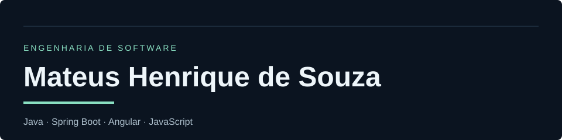

Estudante de **Engenharia de Software na Descomplica UniAmérica**, em Foz do Iguaçu, PR. Conclusão prevista para dezembro de 2028.

Busco **estágio remunerado ou uma oportunidade júnior** em desenvolvimento de software. Pratico interfaces web, integração com APIs, persistência de dados e testes em projetos acadêmicos e de estudo.

## Projetos em destaque

| Projeto | O que explora |
|---|---|
| [ParceiroAuto — Web](https://github.com/Adriannoo/ParceiroAuto) | Gestão contábil com Spring Boot, Angular e PostgreSQL. Projeto em equipe, em desenvolvimento. |
| [ParceiroAuto — Desktop](https://github.com/mateushdsouza/parceiro-auto) | Aplicação Java Swing com persistência JPA/Hibernate, contas e movimentações financeiras. |
| [Wikimon](https://github.com/mateushdsouza/wikimon) | Consumo da PokéAPI, busca, comparação de atributos e favoritos locais em JavaScript. |

No **ParceiroAuto web**, contribuí em diferentes partes, sempre em grupo: integrações de empresas e contas, transações, recorrências, relatórios, testes e documentação. A autoria é compartilhada; os exemplos estão registrados no histórico do projeto.

## Conhecimentos

Tecnologias que utilizo nos projetos e continuo estudando.

### Linguagens

### Frameworks e persistência

### Ferramentas e estudos

Estou cursando **Fullstack**, com estudos de **React, Node.js, HTML, CSS e JavaScript**. Também estudo **APIs REST, testes automatizados, organização de código e AWS**. Os exemplos públicos estão nos [meus repositórios](https://github.com/mateushdsouza?tab=repositories) e no [histórico da graduação](https://github.com/mateushdsouza/faculdade).

## Atividade no GitHub

As estatísticas são fornecidas por um serviço externo e podem ficar indisponíveis. Elas não representam nível de domínio das tecnologias.

## Contato

[LinkedIn](https://www.linkedin.com/in/mateushdsouza/) · [teushdsouza@gmail.com](mailto:teushdsouza@gmail.com)
